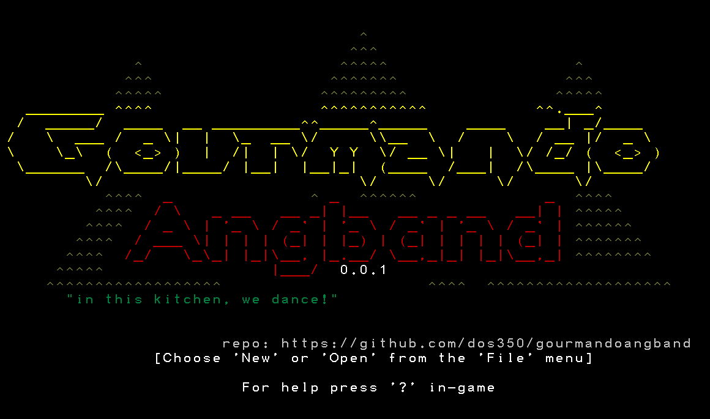
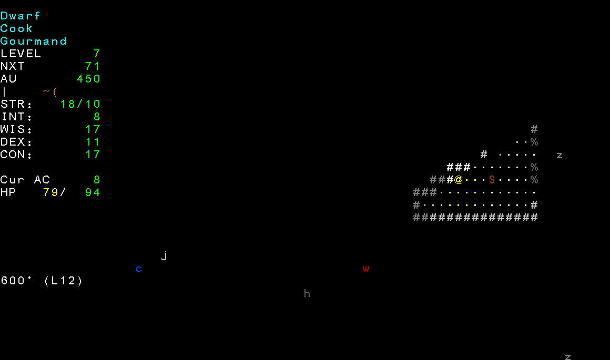

# gourmandoAngband 0.0.1

  
  

gourmandoAngband is an Angband fork with classic sensibilities. It
starts from Angband 4.2.6, whose features and history are the baseline for this
fork. [changes.txt](changes.txt) lists changes made specifically for this fork.

This project is still early, and binary releases are not available yet.

Angband is a graphical dungeon adventure game that uses textual characters to
represent the walls and floors of a dungeon and the inhabitants therein, in the
vein of games like NetHack and Rogue. For in-game help, press `?`.

## Building

See the [compiling guide](docs/hacking/compiling.rst).

## Help

If you need help in-game, press `?`. You can also read the
[Angband manual](https://angband.readthedocs.io/en/latest/) or visit the
[Angband Forums](https://angband.live/forums/).

Enjoy!

-- dos350
